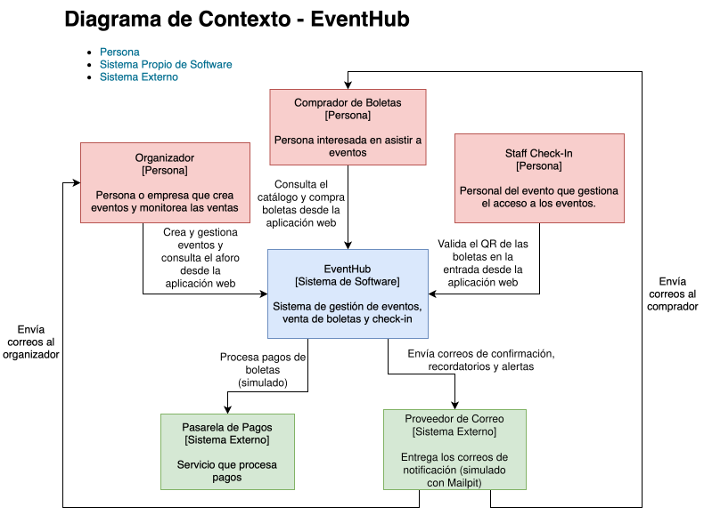
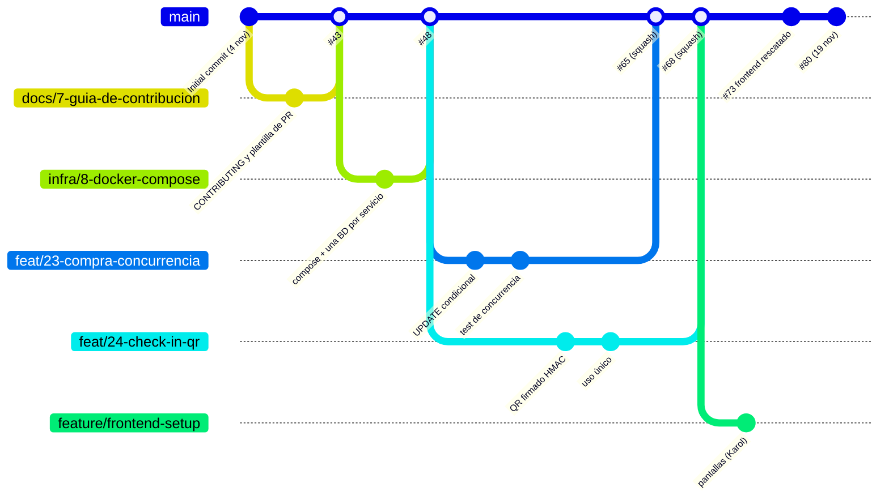

# EventHub: documento final de arquitectura

| | |
|---|---|
| **Proyecto** | EventHub: gestión de eventos, venta de boletas y check-in |
| **Materia** | Diseño y Arquitectura de Software, Proyecto Integrador |
| **Equipo** | Carlos Andrés Vargas Escobar · David Santiago Murcia Barrera · Karol Esquivel |
| **Docente** | _[nombre del docente]_ |
| **Semestre** | _[semestre, p. ej. 2026-2]_ |
| **Entrega final** | 19 de noviembre de 2026 |
| **Repositorio** | https://github.com/vargasesc17/EventHub |

Este documento reúne en un solo lugar la evidencia del proyecto. Cada afirmación enlaza al código, a la prueba o al ADR que la demuestra, para que se pueda verificar en el repositorio. Los cambios respecto a la Entrega 1 aparecen en cajas marcadas **CAMBIO**.

### Cómo se corresponde con la guía de entrega final

| Guía | Sección de este documento |
|---|---|
| A.1 Portada | Esta tabla |
| A.2 Objetivo | [1](#1-objetivo-del-proyecto) |
| A.3 Requerimientos y reglas de negocio | [6](#6-requerimientos-y-reglas-de-negocio) |
| A.4 Diagrama de clases | [8](#8-diseño-interno-clean-architecture-y-diagramas-de-clases) |
| A.5 Patrones de diseño | [10](#10-patrones-de-diseño) |
| A.6 Atributos de calidad | [11](#11-atributos-de-calidad-cómo-los-cumplimos-y-cómo-lo-verificamos) |
| A.7 Estilo arquitectónico y evolución | [3](#3-estilo-arquitectónico-y-evolución) |
| A.8 Stack tecnológico | [4](#4-stack-tecnológico) |
| B.1 Docker | [12](#12-contenerización-con-docker) |
| B.2 C4 niveles 1 y 2 | [5](#5-arquitectura-c4-niveles-1-y-2) |
| B.3 ADRs | [7](#7-decisiones-de-arquitectura-adrs) y [`adr/`](adr/) |
| B.4 Git y trabajo en equipo | [13](#13-trabajo-colaborativo-con-git) |
| B.5 Errores, dificultades y lecciones | [14](#14-errores-dificultades-y-lecciones-aprendidas) |

## Índice

1. [Objetivo del proyecto](#1-objetivo-del-proyecto)
2. [El sistema en una página](#2-el-sistema-en-una-página)
3. [Estilo arquitectónico y evolución](#3-estilo-arquitectónico-y-evolución)
4. [Stack tecnológico](#4-stack-tecnológico)
5. [Arquitectura: C4 niveles 1 y 2](#5-arquitectura-c4-niveles-1-y-2)
6. [Requerimientos y reglas de negocio](#6-requerimientos-y-reglas-de-negocio)
7. [Decisiones de arquitectura (ADRs)](#7-decisiones-de-arquitectura-adrs)
8. [Diseño interno: Clean Architecture y diagramas de clases](#8-diseño-interno-clean-architecture-y-diagramas-de-clases)
9. [SOLID con evidencia en el código](#9-solid-con-evidencia-en-el-código)
10. [Patrones de diseño](#10-patrones-de-diseño)
11. [Atributos de calidad: cómo los cumplimos y cómo lo verificamos](#11-atributos-de-calidad-cómo-los-cumplimos-y-cómo-lo-verificamos)
12. [Contenerización con Docker](#12-contenerización-con-docker)
13. [Trabajo colaborativo con Git](#13-trabajo-colaborativo-con-git)
14. [Errores, dificultades y lecciones aprendidas](#14-errores-dificultades-y-lecciones-aprendidas)
15. [Limitaciones conocidas y trabajo futuro](#15-limitaciones-conocidas-y-trabajo-futuro)
16. [Cómo correr el sistema y las pruebas](#16-cómo-correr-el-sistema-y-las-pruebas)

---

## 1. Objetivo del proyecto

**Objetivo planteado en la Entrega 1:** diseñar e implementar una plataforma de eventos en la que los organizadores crean y publican eventos, los compradores adquieren boletas por categoría sin que se venda más que el aforo, el staff valida en la entrada un QR que no se puede falsificar ni reutilizar, y los compradores reciben por correo la confirmación y los avisos de cambios, todo con una arquitectura de microservicios que siga funcionando aunque una de sus partes falle.

**¿Se cumplió?** Sí, con ajustes de alcance documentados:

| Parte del objetivo | Estado | Evidencia |
|---|---|---|
| Crear, publicar, cambiar y cancelar eventos | ✅ Cumplido | RF-02, `EventoCicloDeVidaTest` |
| Comprar boletas por categoría sin sobreventa | ✅ Cumplido | RF-01, RNF-01, `CompraConcurrenteTest` |
| QR único y no falsificable | ✅ Cumplido | RF-03, RNF-03, `CheckInDePuntaAPuntaTest` |
| Correos de confirmación, recordatorio y cambios | ✅ Cumplido (correo simulado con Mailpit) | RF-04, ADR-0001, ADR-0006 |
| Seguir vendiendo si Notificaciones cae | ✅ Cumplido | RNF-02, `ReintentosTest`, DLQ |
| Reservas de 24 h sin pagar | ⚠️ Fuera del alcance final | Sección 15 |
| Autenticación real | ⚠️ Simulada por alcance | ADR-0012 |
| Pagos reales | ⚠️ Pasarela simulada | C1 y C2 |

## 2. El sistema en una página

EventHub gestiona eventos (conciertos, conferencias, ferias) y la venta de sus boletas con control de aforo. Lo forman tres microservicios en Spring Boot, cada uno con su propia base de datos PostgreSQL, que se comunican de forma asíncrona por RabbitMQ. A eso se suma una aplicación web en React servida por Nginx.

| Microservicio | Responsabilidad | Publica | Consume |
|---|---|---|---|
| **Eventos** | Crear eventos y gestionar su ciclo de vida (borrador → publicado → en curso → finalizado, o cancelado) | `evento.actualizado` | — |
| **Boletería** | Inventario por categoría, compra, QR firmado, check-in, aforo | `boleta.comprada`, `evento.aforo.critico` | `evento.actualizado` |
| **Notificaciones** | Correos de confirmación con QR, recordatorio de 24 h, avisos de cambio o cancelación, alerta al organizador | — | los tres |

La API REST está documentada con OpenAPI (Swagger): [`api/eventos.openapi.yaml`](api/eventos.openapi.yaml) y [`api/boleteria.openapi.yaml`](api/boleteria.openapi.yaml). Los mensajes tienen contratos con esquema JSON en [`contratos/`](contratos/).

## 3. Estilo arquitectónico y evolución

**Estilo final: microservicios orientados a eventos**, con Clean Architecture dentro de cada servicio.

- **Tres microservicios** (Eventos, Boletería, Notificaciones), cada uno desplegable por separado y con **su propia base de datos** ([ADR-0002](adr/0002-base-de-datos-por-microservicio.md)).
- **Comunicación asíncrona** por RabbitMQ con publicación/suscripción ([ADR-0001](adr/0001-comunicacion-asincrona-rabbitmq.md)): ningún servicio llama a otro por HTTP para completar una operación.
- **Un único punto de entrada** para el navegador: Nginx sirve la aplicación web y enruta `/api/*` a cada servicio ([ADR-0005](adr/0005-acceso-frontend.md)).
- **Clean Architecture** en cada servicio, verificada con ArchUnit ([ADR-0007](adr/0007-clean-architecture-verificada-con-archunit.md)).

**Comparación con la propuesta inicial.** El estilo se mantuvo (microservicios con mensajería); lo que cambió fue el reparto de responsabilidades y algunos contenedores:

> **CAMBIO 1: el aforo pasa de Eventos a Boletería.**
> **Qué cambió:** la propuesta inicial ponía el control del aforo en Eventos (siguiendo el ejemplo de SRP del enunciado). Ahora Eventos solo *define* el aforo máximo y Boletería controla el inventario, descuenta cada compra y publica `evento.aforo.critico`.
> **Por qué:** la verificación "hay cupo" y el descuento deben ser una sola operación atómica en una sola base; repartirla entre dos servicios permitía sobrevender (RNF-01).
> **Impacto:** Boletería consume `evento.actualizado` para crear su inventario; se corrigió el C2 (Eventos ya no dice "aforo") y el ADR-0003 (commit `0b9e803`, 11 nov).

> **CAMBIO 2: Nginx como punto de entrada del frontend.**
> **Qué cambió:** el navegador ya no llama a cada microservicio por su puerto; Nginx sirve la SPA y enruta `/api/eventos/**` y `/api/boleteria/**`.
> **Por qué:** evitar CORS y no exponer los servicios al navegador.
> **Impacto:** nuevo contenedor en el C2 (`658cbc3`, 9 nov) y ADR-0005; la aplicación web se agregó al C1 y C2 en #70.

> **CAMBIO 3: Notificaciones tiene su propia base de datos.**
> **Qué cambió:** se agregó **BD Notificaciones**, con el registro de envíos y una copia de los compradores por evento.
> **Por qué:** para avisar a los compradores de un evento cancelado sin preguntarle a Boletería en el momento (RNF-02) y para no enviar dos veces el mismo correo (idempotencia).
> **Impacto:** ADR-0006 y nuevo contenedor en el C2.

> **CAMBIO 4: proveedor de correo simulado con Mailpit.**
> **Qué cambió:** el "proveedor de correo en la nube" se reemplaza en esta entrega por Mailpit, que recibe los correos por SMTP y los muestra en una página web.
> **Por qué:** no depender de cuentas ni claves de un proveedor real para la demo.
> **Impacto:** el C1 y el C2 lo indican; cambiar a un proveedor real solo requiere cambiar la configuración SMTP del adaptador.

> **CAMBIO 5: documentación de la API generada desde el código.**
> **Qué cambió:** la documentación manual de endpoints (#66) se reemplazó por Swagger/OpenAPI generado con springdoc (#75).
> **Por qué:** la manual se desactualizó en pocos días.
> **Impacto:** [ADR-0014](adr/0014-documentacion-de-api-code-first.md).

## 4. Stack tecnológico

| Capa | Tecnología | Versión |
|---|---|---|
| Lenguaje backend | Java (Eclipse Temurin) | 25 |
| Framework | Spring Boot (Web, Data JPA, AMQP, Validation, Actuator, Mail) | 4.1.2 |
| JSON | Jackson | 3 (paquete `tools.jackson`) |
| Documentación de API | springdoc-openapi (Swagger UI) | `springdoc-openapi-starter-webmvc-ui` |
| Build | Maven (wrapper `mvnw`; imagen `maven:3.10.0-eclipse-temurin-25`) | 3.10.0 |
| Base de datos | PostgreSQL | 16 |
| Base de datos de pruebas | H2 (en memoria) | la del BOM de Spring Boot 4.1.2 |
| Mensajería | RabbitMQ con panel de administración | 3.13 (`rabbitmq:3.13-management`) |
| Correo | Mailpit (SMTP 1025, web 8025) | `axllent/mailpit` |
| Pruebas | JUnit 5, Spring Boot Test, ArchUnit | ArchUnit 1.5.1 |
| Frontend | React, React Router, Vite | React 19.3, Router 7.18, Vite 8.3 |
| Servidor web | Nginx | 1.27 (alpine) |
| Build del frontend | Node.js | 22 (alpine) |
| Contenedores | Docker y Docker Compose | Compose v2 |
| Control de versiones | Git + GitHub (issues, PR, protección de rama) | — |

## 5. Arquitectura: C4 niveles 1 y 2

### Nivel 1: Contexto



EventHub es una sola caja frente a sus tres actores (comprador, organizador y staff de check-in) y a dos sistemas externos: la pasarela de pagos y el proveedor de correo, ambos **simulados** en esta entrega. Las relaciones se describen en lenguaje del negocio, sin protocolos.

### Nivel 2: Contenedores


Por dentro:

- **Aplicación web** (React + Nginx), único punto de entrada ([ADR-0005](adr/0005-acceso-frontend.md)).
- **Tres microservicios** Spring Boot: Eventos gestiona eventos, ciclo de vida y catálogo; **Boletería es dueña del aforo**, la venta, el QR y el check-in ([ADR-0003](adr/0003-control-de-concurrencia-y-dueno-del-aforo.md)); Notificaciones arma y envía los correos.
- **Una base PostgreSQL por servicio**: BD Eventos, BD Boletería y **BD Notificaciones** ([ADR-0002](adr/0002-base-de-datos-por-microservicio.md), [ADR-0006](adr/0006-replica-de-compradores-en-notificaciones.md)).
- **Broker RabbitMQ** con los tres eventos de dominio ([ADR-0001](adr/0001-comunicacion-asincrona-rabbitmq.md)).
- **Proveedor de correo simulado con Mailpit** (SMTP 1025, buzón web 8025).

**Correspondencia con `docker-compose.yml`:**

| Contenedor del C2 | Servicio en Compose | Puerto en el equipo |
|---|---|---|
| Aplicación Web | `frontend` | 8080 |
| Microservicio Eventos | `eventos` | 8081 |
| Microservicio Boletería | `boleteria` | 8082 |
| Microservicio Notificaciones | `notificaciones` | 8083 |
| BD Eventos, BD Boletería, BD Notificaciones | `postgres` (una instancia con tres bases y un usuario por base) | 5432 |
| Broker de Mensajes | `rabbitmq` | 5672, panel 15672 |
| Proveedor de Correo (simulado) | `mailpit` | 1025, web 8025 |

Las tres bases viven en una sola instancia de PostgreSQL para ahorrar recursos en el portátil, pero cada servicio tiene su base y su usuario, sin permisos sobre las de los demás (ADR-0002).

## 6. Requerimientos y reglas de negocio

Están definidos con criterios de aceptación y trazabilidad a contenedores, ADRs e issues en [`requerimientos.md`](requerimientos.md). Estado final:

| ID | Requerimiento | Servicio | ¿Implementado? | ADR |
|---|---|---|---|---|
| RF-01 | Compra de boletas por categoría | Boletería | ✅ Compra · ⚠️ La reserva de 24 h quedó fuera del alcance | 0003, 0008 |
| RF-02 | Creación de eventos y ciclo de vida | Eventos | ✅ | 0007, 0009 |
| RF-03 | Check-in con QR de uso único | Boletería | ✅ | 0004, 0008 |
| RF-04 | Notificaciones por correo a los compradores | Notificaciones | ✅ (correo simulado con Mailpit) | 0001, 0006 |
| RF-05 | Consulta del aforo y alerta al 90 % | Boletería y Notificaciones | ✅ | 0001, 0003 |
| RF-06 | Catálogo de eventos disponibles | Eventos | ✅ | 0005 |
| RNF-01 | Consistencia: no sobrevender | Boletería | ✅ | 0003, 0008, 0010 |
| RNF-02 | Disponibilidad ante caída de Notificaciones | Todos | ✅ | 0001, 0002, 0006 |
| RNF-03 | Seguridad: QR único y no falsificable | Boletería | ✅ | 0004 |
| RNF-04 | Rendimiento del catálogo y la compra | Eventos y Boletería | ⚠️ Diseño cumplido; sin prueba de carga formal | 0003, 0005 |

**Fuera del alcance:** reservas de 24 h sin pagar, autenticación real con JWT (#32, [ADR-0012](adr/0012-autenticacion-simulada.md)), panel de estadísticas en tiempo real y PDF de la boleta (#33), pagos reales.

### Reglas de negocio implementadas

| Regla | Dónde se aplica | Respuesta si se incumple |
|---|---|---|
| Un evento debe tener fecha futura | `Evento.crear` (Eventos) | 422 |
| La suma de cupos de las categorías no supera el aforo | `Evento.crear` | 422 |
| La boleta de cortesía no tiene precio | `CategoriaBoleta` | 422 |
| La boleta de estudiante exige carné | `FabricaBoleta` (Boletería) | 422 |
| No se vende por encima de los cupos de la categoría | `UPDATE` condicional | 409 |
| No se compra en un evento cancelado | `ComprarBoletaUseCase` | 422 |
| Al cancelar un evento, sus boletas quedan canceladas | `SincronizarEventoUseCase` (#74) | — |
| Alerta al organizador al llegar al 90 % del aforo, una sola vez | `UPDATE` condicional sobre `alerta_enviada` | — |
| Un QR solo se usa una vez y solo en su evento | `CheckInUseCase` (#68, #77) | 409 |

## 7. Decisiones de arquitectura (ADRs)

Son 14 y están en [`adr/`](adr/). Cada una tiene fecha, estado, contexto, decisión, opciones evaluadas (con complejidad, costo, escalabilidad y familiaridad del equipo) y consecuencias. La **fecha** es el día en que la decisión entró al proyecto según el historial de `main`; los ADR 0007 a 0014 se redactaron el 19 de noviembre a partir de decisiones ya aplicadas en el código, y lo indican con la línea **Documentado**.

| ADR | Decisión | Fecha | Requerimientos | Responsable |
|---|---|---|---|---|
| [0001](adr/0001-comunicacion-asincrona-rabbitmq.md) | Comunicación asíncrona entre servicios con RabbitMQ | 2026-11-09 | RF-04, RF-05, RNF-02 | David |
| [0002](adr/0002-base-de-datos-por-microservicio.md) | Una base de datos por microservicio | 2026-11-09 | RNF-01, RNF-02 | David |
| [0003](adr/0003-control-de-concurrencia-y-dueno-del-aforo.md) | Boletería es dueña del aforo; descuento con UPDATE condicional atómico | 2026-11-09 | RNF-01, RF-05 | Carlos |
| [0004](adr/0004-qr-unico-y-no-falsificable.md) | QR = `boletaId.firma` con HMAC-SHA256 | 2026-11-09 | RF-03, RNF-03 | Carlos |
| [0005](adr/0005-acceso-frontend.md) | Nginx como único punto de entrada del frontend | 2026-11-09 | RF-06, RNF-04 | Karol |
| [0006](adr/0006-replica-de-compradores-en-notificaciones.md) | Notificaciones guarda su propia copia de los compradores por evento | 2026-11-09 | RF-04, RNF-02 | David |
| [0007](adr/0007-clean-architecture-verificada-con-archunit.md) | Clean Architecture por servicio, verificada con ArchUnit | 2026-11-12 | Todos | Carlos, David |
| [0008](adr/0008-spring-boot-y-jpa-con-updates-condicionales.md) | Spring Boot + Spring Data JPA con UPDATE condicionales | 2026-11-12 | RNF-01, RNF-03 | Carlos |
| [0009](adr/0009-errores-con-problemdetail.md) | Errores con ProblemDetail (RFC 9457): 400/404/409/422 | 2026-11-15 | RF-01–RF-03 | Carlos |
| [0010](adr/0010-estrategia-de-pruebas.md) | Pruebas: fakes, H2, ArchUnit y concurrencia | 2026-11-12 | RNF-01–RNF-03 | David |
| [0011](adr/0011-github-flow.md) | GitHub Flow en lugar de Gitflow | 2026-11-09 | Trabajo en equipo | Carlos |
| [0012](adr/0012-autenticacion-simulada.md) | Sesión simulada por rol, sin JWT | 2026-11-18 | RF-01–RF-03, RF-06 | Karol |
| [0013](adr/0013-ddl-auto-update-en-lugar-de-flyway.md) | `ddl-auto: update` en lugar de Flyway (deuda técnica) | 2026-11-15 | Operación | David |
| [0014](adr/0014-documentacion-de-api-code-first.md) | Documentación de API desde el código (springdoc) | 2026-11-18 | RF-01–RF-03, RF-06 | Carlos |

## 8. Diseño interno: Clean Architecture y diagramas de clases

Cada microservicio tiene cuatro capas, y las dependencias solo apuntan hacia adentro:

```
interfaces  (controladores REST, consumidores de RabbitMQ)
     ↓
application (casos de uso y puertos: interfaces que el dominio necesita)
     ↓
domain      (entidades, value objects y reglas; Java puro, sin Spring)
     ↑
infrastructure (adaptadores: JPA, RabbitMQ, SMTP, HMAC; implementan los puertos)
```

No es solo una convención: lo **verifica una prueba automática con ArchUnit** en cada servicio ([Eventos](../services/eventos/src/test/java/com/eventhub/eventos/ArquitecturaTest.java), [Boletería](../services/boleteria/src/test/java/com/eventhub/boleteria/ArquitecturaTest.java), [Notificaciones](../services/notificaciones/src/test/java/com/eventhub/notificaciones/ArquitecturaTest.java)). Si alguien importa Spring o JPA en el dominio, o hace que la aplicación dependa de la infraestructura, el build falla.

```java
static final ArchRule domainNoDependeDeNadie = noClasses().that().resideInAPackage("..domain..")
        .should().dependOnClassesThat()
        .resideInAnyPackage("..application..", "..infrastructure..", "..interfaces..",
                "org.springframework..", "jakarta..", "org.hibernate..");
```

### Diagramas de clases

| Servicio | Diagrama | Qué muestra |
|---|---|---|
| Eventos | [clases-eventos](diagramas/clases-eventos.svg) ([.puml](diagramas/clases-eventos.puml)) | Agregado `Evento` con su máquina de estados y `CategoriaBoleta` |
| Boletería | [clases-boleteria](diagramas/clases-boleteria.svg) ([.puml](diagramas/clases-boleteria.puml)) | Jerarquía de boletas, Factory Method, Strategy, ISP y DIP |
| Notificaciones | [clases-notificaciones](diagramas/clases-notificaciones.svg) ([.puml](diagramas/clases-notificaciones.puml)) | Consumidores, casos de uso y copia local de eventos y compradores |

**Entidades siempre válidas.** Los objetos de dominio no se pueden construir en un estado inválido: `Evento.crear(...)` rechaza un evento sin categorías, con más cupos que aforo o con fecha pasada; `CategoriaBoleta` es un `record` que rechaza cupos ≤ 0 o una cortesía con precio. Los constructores son privados y se usan métodos de fábrica (`crear` para algo nuevo, `reconstruir` para lo que viene de la base). Así la regla vive en un solo lugar y ningún caso de uso se la puede saltar.

## 9. SOLID con evidencia en el código

### S: Responsabilidad única (SRP)

> Una clase debe tener una sola razón para cambiar.

- **Entre servicios:** las reglas de un evento (fechas, estados, categorías) cambian solo en Eventos; la generación y validación del QR cambia solo en Boletería; las plantillas de correo cambian solo en Notificaciones.
- **Dentro de un servicio:** la compra ([`ComprarBoletaUseCase`](../services/boleteria/src/main/java/com/eventhub/boleteria/application/ComprarBoletaUseCase.java)) *orquesta*, pero no sabe calcular precios (eso es de `PrecioStrategy`), ni armar boletas (de `FabricaBoleta`), ni firmar QR (de `GeneradorQr`), ni hablar con RabbitMQ (de `PublicadorBoleteria`). Si cambia el algoritmo de firma, solo cambia [`GeneradorQrHmac`](../services/boleteria/src/main/java/com/eventhub/boleteria/infrastructure/qr/GeneradorQrHmac.java).

### O: Abierto/cerrado (OCP)

> Abierto a extensión, cerrado a modificación.

Agregar un tipo de precio nuevo (por ejemplo, "2x1") se hace **sin tocar la compra**: se crea una clase que implementa [`PrecioStrategy`](../services/boleteria/src/main/java/com/eventhub/boleteria/domain/PrecioStrategy.java), se registra como bean en [`EstrategiasConfig`](../services/boleteria/src/main/java/com/eventhub/boleteria/infrastructure/EstrategiasConfig.java) y [`RegistroEstrategias`](../services/boleteria/src/main/java/com/eventhub/boleteria/application/RegistroEstrategias.java) la encuentra por su `tipo()`. Pasa lo mismo con un tipo de boleta nuevo: una subclase de `FabricaBoleta` más su registro en `FabricasConfig`.

```java
// ComprarBoletaUseCase: esta línea no cambia aunque se agreguen 10 estrategias nuevas
long precio = estrategias.estrategiaPara(inventario.tipoPrecio())
        .calcular(inventario.contextoPrecio(reloj.instant()));
var boleta = fabricas.fabricaPara(categoria).emitir(compra, precio);
```

### L: Sustitución de Liskov (LSP)

> Una subclase debe poder usarse en lugar de su clase base sin romper el comportamiento.

`BoletaGeneral`, `BoletaVIP`, `BoletaEstudiante` y `BoletaCortesia` son intercambiables en el check-in: el caso de uso trabaja con [`Boleta`](../services/boleteria/src/main/java/com/eventhub/boleteria/domain/Boleta.java) y nunca pregunta por el tipo concreto. Para garantizarlo, la regla de ingreso es `final`, así que ninguna subclase puede cambiarla:

```java
/** La regla es la MISMA para VIP, General, Estudiante y Cortesía; ninguna subclase la puede cambiar (LSP). */
public final boolean puedeIngresar() {
    return estado == EstadoBoleta.ACTIVA;
}
```

Las subclases solo **agregan** invariantes propias (la de estudiante exige carnet; la cortesía exige quién la emitió y precio 0), y no debilitan las de la base.

### I: Segregación de interfaces (ISP)

> Ningún cliente debe depender de métodos que no usa.

El check-in depende de [`CheckInService`](../services/boleteria/src/main/java/com/eventhub/boleteria/application/CheckInService.java), una interfaz con un solo método (`validar`). El controlador del staff ([`CheckInController`](../services/boleteria/src/main/java/com/eventhub/boleteria/interfaces/CheckInController.java)) no ve nada de la compra, y [`BoletaController`](../services/boleteria/src/main/java/com/eventhub/boleteria/interfaces/BoletaController.java) no ve nada del check-in.

Pasa lo mismo con el QR: [`GeneradorQr`](../services/boleteria/src/main/java/com/eventhub/boleteria/application/GeneradorQr.java) (lo usa la compra) y [`ValidadorQr`](../services/boleteria/src/main/java/com/eventhub/boleteria/application/ValidadorQr.java) (lo usa el check-in) son dos interfaces separadas, aunque las implemente la misma clase `GeneradorQrHmac`. La compra no puede validar QR y el check-in no puede emitirlos.

### D: Inversión de dependencias (DIP)

> Los módulos de alto nivel dependen de abstracciones, no de detalles.

Los casos de uso declaran **puertos** (interfaces en `application`), y la infraestructura los implementa:

| Puerto (abstracción) | Adaptador (detalle) |
|---|---|
| [`InventarioRepository`](../services/boleteria/src/main/java/com/eventhub/boleteria/application/InventarioRepository.java) | [`JpaInventarioRepository`](../services/boleteria/src/main/java/com/eventhub/boleteria/infrastructure/persistencia/JpaInventarioRepository.java) |
| [`PublicadorBoleteria`](../services/boleteria/src/main/java/com/eventhub/boleteria/application/PublicadorBoleteria.java) | [`RabbitPublicadorBoleteria`](../services/boleteria/src/main/java/com/eventhub/boleteria/infrastructure/messaging/RabbitPublicadorBoleteria.java) |
| [`PasarelaPagos`](../services/boleteria/src/main/java/com/eventhub/boleteria/application/PasarelaPagos.java) | [`PasarelaPagosSimulada`](../services/boleteria/src/main/java/com/eventhub/boleteria/infrastructure/pagos/PasarelaPagosSimulada.java) |
| [`PublicadorEventos`](../services/eventos/src/main/java/com/eventhub/eventos/application/PublicadorEventos.java) | [`RabbitPublicadorEventos`](../services/eventos/src/main/java/com/eventhub/eventos/infrastructure/messaging/RabbitPublicadorEventos.java) |
| [`EnviadorCorreo`](../services/notificaciones/src/main/java/com/eventhub/notificaciones/application/EnviadorCorreo.java) | [`SmtpEnviadorCorreo`](../services/notificaciones/src/main/java/com/eventhub/notificaciones/infrastructure/correo/SmtpEnviadorCorreo.java) |

Dos consecuencias concretas:

1. **Las pruebas no necesitan infraestructura.** Las pruebas de casos de uso usan fakes en memoria (`InventariosEnMemoria`, `PasarelaFalsa`, `PublicadorEnMemoria`), y por eso corren en milisegundos.
2. **Cambiar un proveedor no toca el negocio.** Conectar una pasarela real (PayU, Wompi) es escribir un adaptador nuevo de `PasarelaPagos`; la compra no cambia.

Hasta el tiempo es una dependencia invertida: los casos de uso reciben un `Clock` y el dominio recibe `Instant ahora` como parámetro, en vez de llamar a `Instant.now()`. Así las reglas que dependen del tiempo (early bird, fecha futura) se prueban de forma determinista.

## 10. Patrones de diseño

### 10.1 Factory Method: tipos de boleta

**Problema.** Hay cuatro tipos de boleta con reglas distintas: la VIP trae beneficios, la de estudiante exige carnet y la cortesía exige quién la emitió y no se cobra. Si la compra los creara con un `switch` por tipo, cada tipo nuevo obligaría a modificar la compra (viola OCP), y las reglas de cada tipo quedarían mezcladas en un solo método.

**Solución.** [`FabricaBoleta`](../services/boleteria/src/main/java/com/eventhub/boleteria/domain/FabricaBoleta.java) define el flujo común en un método `final` (`emitir`) y deja a cada subclase decidir *qué clase concreta crear* (`crearBoleta`, el factory method). [`RegistroFabricas`](../services/boleteria/src/main/java/com/eventhub/boleteria/application/RegistroFabricas.java) elige la fábrica según la categoría.

```java
public abstract class FabricaBoleta {
    public abstract TipoBoleta tipo();

    /** Lo que usa la compra. Es final: las subclases no pueden cambiar este flujo. */
    public final Boleta emitir(Compra compra, long precio) {
        if (compra.categoria() != tipo()) {
            throw new ReglaDeNegocioException(
                    "La fábrica de " + tipo() + " no puede emitir una boleta " + compra.categoria());
        }
        return crearBoleta(compra, precio);
    }

    /** El "factory method": cada subclase decide qué clase concreta crear. */
    protected abstract Boleta crearBoleta(Compra compra, long precio);
}
```

**Evidencia:** [`FabricaBoletaTest`](../services/boleteria/src/test/java/com/eventhub/boleteria/domain/FabricaBoletaTest.java), [`RegistroFabricasTest`](../services/boleteria/src/test/java/com/eventhub/boleteria/application/RegistroFabricasTest.java), [`BoletaTest`](../services/boleteria/src/test/java/com/eventhub/boleteria/domain/BoletaTest.java).

### 10.2 Strategy: precios

**Problema.** El precio de una boleta se calcula de tres formas: fijo, early bird (descuento si se compra antes de una fecha límite) y dinámico (sube con la ocupación). Con `if/else` dentro de la compra, cada regla nueva tocaría el flujo más delicado del sistema.

**Solución.** La interfaz [`PrecioStrategy`](../services/boleteria/src/main/java/com/eventhub/boleteria/domain/PrecioStrategy.java) tiene tres implementaciones intercambiables: [`PrecioFijo`](../services/boleteria/src/main/java/com/eventhub/boleteria/domain/PrecioFijo.java), [`PrecioEarlyBird`](../services/boleteria/src/main/java/com/eventhub/boleteria/domain/PrecioEarlyBird.java) y [`PrecioDinamico`](../services/boleteria/src/main/java/com/eventhub/boleteria/domain/PrecioDinamico.java). Cada categoría del inventario guarda su `TipoPrecio`, y la compra pide la estrategia en tiempo de ejecución. Toda la información que necesitan llega en un `ContextoPrecio` inmutable.

```java
public interface PrecioStrategy {
    TipoPrecio tipo();
    long calcular(ContextoPrecio contexto);   // precio de UNA boleta en pesos
}

public class PrecioEarlyBird implements PrecioStrategy {
    public long calcular(ContextoPrecio contexto) {
        var p = contexto.parametros();
        // (validaciones de fecha límite y descuento entre 1 y 100)
        if (contexto.fechaCompra().isBefore(p.fechaLimite())) {
            return contexto.precioBase() * (100 - p.descuentoPorcentaje()) / 100;
        }
        return contexto.precioBase();
    }
}
```

**Evidencia:** [`PrecioStrategyTest`](../services/boleteria/src/test/java/com/eventhub/boleteria/domain/PrecioStrategyTest.java) (early bird antes y después de la fecha límite, dinámico según ocupación, con un reloj fijo) y [`RegistroEstrategiasTest`](../services/boleteria/src/test/java/com/eventhub/boleteria/application/RegistroEstrategiasTest.java).

### 10.3 Observer (publicación/suscripción): cambios del evento

**Problema.** Cuando un evento se cancela o cambia de fecha o lugar, hay que avisar a todos los compradores y actualizar el inventario. Si Eventos llamara directamente a Notificaciones y a Boletería, quedaría acoplado a ellos: una caída de Notificaciones haría fallar la cancelación, y agregar un nuevo interesado obligaría a modificar Eventos.

**Solución.** Observer a nivel de arquitectura, con RabbitMQ como intermediario. Eventos (el *sujeto*) publica `evento.actualizado` en un exchange y no sabe quién escucha. Boletería y Notificaciones (los *observadores*) se suscriben con su propia cola. Agregar un nuevo observador (por ejemplo, un servicio de analítica) es crear una cola nueva: Eventos no cambia.

```java
// Eventos: el sujeto solo conoce el puerto, no a sus observadores
publicador.eventoActualizado(evento, Set.of(TipoCambio.CANCELADO), null);

// Boletería: un observador bloquea las ventas y cancela las boletas
if (cambios.contains(TipoCambio.CANCELADO)) {
    aforos.bloquearVentas(eventoId);
    boletas.cancelarPorEvento(eventoId);
}

// Notificaciones: otro observador avisa a cada comprador (un correo por persona)
```

El mismo patrón se usa con `boleta.comprada` (Boletería → Notificaciones, correo con QR) y `evento.aforo.critico` (Boletería → Notificaciones, alerta al organizador). Los contratos están en [`contratos/`](contratos/).

Como la entrega es *al menos una vez*, los observadores son **idempotentes**: guardan el `messageId` de cada mensaje procesado e ignoran los repetidos, e ignoran los mensajes viejos que llegan fuera de orden (por `fechaEmision`).

**Evidencia:** [`SincronizarEventoUseCaseTest`](../services/boleteria/src/test/java/com/eventhub/boleteria/application/SincronizarEventoUseCaseTest.java), [`ProcesarEventoActualizadoUseCaseTest`](../services/notificaciones/src/test/java/com/eventhub/notificaciones/application/ProcesarEventoActualizadoUseCaseTest.java) y [`ProcesarBoletaCompradaUseCaseTest`](../services/notificaciones/src/test/java/com/eventhub/notificaciones/application/ProcesarBoletaCompradaUseCaseTest.java) (incluye `unMensajeRepetidoNoEnviaOtroCorreo`).

### Otros patrones que aparecen

- **Ports & Adapters (Hexagonal):** los puertos y adaptadores de la sección DIP.
- **Repository:** `EventoRepository`, `BoletaRepository`, etc., ocultan JPA al dominio.
- **State (en forma de máquina de estados):** [`EstadoEvento.puedePasarA`](../services/eventos/src/main/java/com/eventhub/eventos/domain/EstadoEvento.java) concentra las transiciones permitidas.
- **Registry:** `RegistroFabricas` y `RegistroEstrategias` resuelven la implementación por tipo.

## 11. Atributos de calidad: cómo los cumplimos y cómo lo verificamos

### RNF-01: Consistencia (no sobrevender)

**Cómo lo cumplimos ([ADR-0003](adr/0003-control-de-concurrencia-y-dueno-del-aforo.md)).** El patrón ingenuo "leo los disponibles, compruebo que haya y resto" (*check-then-act*) falla con compras simultáneas: dos compras leen "queda 1" y ambas venden. Por eso la condición la evalúa **la base de datos en una sola sentencia atómica**:

```sql
update InventarioCategoriaEntity i
set i.disponibles = i.disponibles - 1, i.vendidas = i.vendidas + 1
where i.eventoId = :eventoId and i.categoria = :categoria and i.disponibles >= 1
```

Si la sentencia afecta 0 filas, no había cupo y la compra se rechaza con 409. Todo ocurre en una transacción: si el pago se rechaza después de descontar, el cupo vuelve. La alerta del 90 % usa la misma técnica (`... and a.alertaEnviada = false`), así que se publica **una sola vez** aunque varias compras crucen el umbral al mismo tiempo. Y el check-in pasa la boleta de ACTIVA a USADA con un UPDATE condicional, así que el mismo QR no entra dos veces aunque lo escaneen en dos puertas a la vez.

**Cómo lo verificamos.**
- Prueba automática [`CompraConcurrenteTest.cienCompradoresPorDiezCuposNuncaVendenDeMas`](../services/boleteria/src/test/java/com/eventhub/boleteria/CompraConcurrenteTest.java): 100 hilos compran a la vez sobre 10 cupos (con un `CountDownLatch` para que arranquen juntos). Resultado: exactamente 10 compras exitosas, 90 "sin cupos", y 10 boletas en la base.
- `siElPagoSeRechazaElCupoVuelveAlInventario` en la misma clase.
- Manual, sobre Docker: 50 `curl` en paralelo contra una categoría con 8 cupos dieron 8 respuestas 201 y 42 respuestas 409, y la alerta de aforo se publicó una sola vez.

### RNF-02: Disponibilidad (Notificaciones caído)

**Cómo lo cumplimos ([ADR-0001](adr/0001-comunicacion-asincrona-rabbitmq.md), [ADR-0006](adr/0006-replica-de-compradores-en-notificaciones.md)).**
- La compra no llama a Notificaciones: publica `boleta.comprada` y termina. Si Notificaciones está caído, el mensaje espera en una **cola durable** de RabbitMQ.
- Boletería publica **después del commit** (`TransactionSynchronization.afterCommit`): nunca se envía un correo por una compra que luego se deshizo.
- Las colas tienen **cola de mensajes muertos (DLQ)**: un mensaje que falla tras los reintentos no se pierde, queda para revisión.
- Notificaciones guarda su propia copia de compradores y eventos (ADR-0006), así que puede avisar de una cancelación sin preguntarle nada a Boletería.
- Cada servicio tiene su propia base (ADR-0002): la caída de una base no tumba a los otros servicios.

**Cómo lo verificamos.**
- Manual (se muestra en la demo): `docker compose stop notificaciones` → se hacen compras, que responden 201 → en el panel de RabbitMQ (http://localhost:15672) se ven los mensajes acumulados en `notificaciones.boleta-comprada` → `docker compose start notificaciones` → los correos llegan a Mailpit, uno por compra, sin duplicados.
- Idempotencia: `unMensajeRepetidoNoEnviaOtroCorreo` y `siElCorreoFallaNoMarcaElMensajeComoProcesado` en [`ProcesarBoletaCompradaUseCaseTest`](../services/notificaciones/src/test/java/com/eventhub/notificaciones/application/ProcesarBoletaCompradaUseCaseTest.java).

### RNF-03: Seguridad (QR único y no falsificable)

**Cómo lo cumplimos ([ADR-0004](adr/0004-qr-unico-y-no-falsificable.md)).** El QR es `boletaId.firma`, donde la firma es **HMAC-SHA256** del id de la boleta con una clave secreta que solo conoce Boletería (`BOLETERIA_QR_SECRETO`, en variables de entorno y nunca en el repositorio).
- **Único:** el `boletaId` es un UUID.
- **No falsificable:** sin la clave no se puede calcular la firma de otra boleta, aunque se conozca el código de una.
- **Comparación segura:** la firma se compara con `MessageDigest.isEqual` (tiempo constante), para no filtrar información por tiempos de respuesta.
- **Uso único:** el check-in cambia la boleta de ACTIVA a USADA de forma atómica (RNF-01).
- **Boleta del evento correcto:** el staff valida en la entrada de un evento concreto (`eventoId`); un QR auténtico de otro evento se rechaza y no se marca como usada.

**Cómo lo verificamos.** [`ValidacionQrHmacTest`](../services/boleteria/src/test/java/com/eventhub/boleteria/infrastructure/qr/ValidacionQrHmacTest.java): una letra cambiada en la firma se rechaza, poner la firma de una boleta en otra se rechaza y un QR firmado con otra clave se rechaza. [`GeneradorQrHmacTest`](../services/boleteria/src/test/java/com/eventhub/boleteria/infrastructure/qr/GeneradorQrHmacTest.java): el servicio no arranca sin secreto. [`CheckInDePuntaAPuntaTest`](../services/boleteria/src/test/java/com/eventhub/boleteria/CheckInDePuntaAPuntaTest.java): con el QR de la compra se entra una sola vez, un QR alterado responde 409 y en la entrada de otro evento se rechaza sin gastar la boleta (`enLaEntradaDeOtroEventoSeRechazaYLaBoletaSigueActiva`).

### RNF-04: Rendimiento

**Cómo lo cumplimos.** La compra hace pocas operaciones cortas en una transacción, sin bloqueos largos (el UPDATE condicional bloquea solo la fila de esa categoría). El correo y el QR en imagen se generan fuera de la compra, en Notificaciones. El catálogo es una sola consulta filtrada por estado y fecha.

**Cómo lo verificamos.** Con la prueba de concurrencia y los 50 `curl` en paralelo. **No hicimos una prueba de carga formal** con medición de percentil 95 (JMeter, k6 o Gatling); queda como trabajo futuro (sección 15).

## 12. Contenerización con Docker

Todo el sistema se levanta con un solo comando desde la raíz del repositorio:

```bash
cp .env.example .env        # y cambiar las contraseñas
docker compose up -d --build
```

### Dockerfiles (multi-stage)

| Imagen | Etapa de build | Etapa de ejecución | Detalles |
|---|---|---|---|
| `eventos`, `boleteria`, `notificaciones` | `maven:3.10.0-eclipse-temurin-25`: descarga dependencias (`dependency:go-offline`, queda en caché) y empaqueta el JAR | `eclipse-temurin:25-jre` (solo JRE) | Usuario sin privilegios `usr_eventhub`; `curl` para el health check; `ENTRYPOINT ["java", "-jar", "app.jar"]` |
| `frontend` | `node:22-alpine`: `npm ci` y `npm run build` | `nginx:1.27-alpine` | Nginx sirve la SPA y hace de proxy de `/api/*` |
| `postgres` | — | `postgres:16` + script `infra/postgres/init/01-crear-bases.sh` | Crea las tres bases y un usuario por base (ver error 1 en la sección 14) |

### docker-compose.yml

| Criterio de la guía | Cómo se cumple |
|---|---|
| Redes propias, no la red por defecto | Cuatro redes: `eventhub_frontend` (frontend ↔ Eventos y Boletería), `eventhub_mensajeria` (servicios ↔ RabbitMQ), `eventhub_datos` (servicios ↔ PostgreSQL) y `eventhub_correo` (Notificaciones ↔ Mailpit). Así el frontend no ve la base de datos y solo Notificaciones ve Mailpit. |
| Volúmenes persistentes | `postgres_data` y `rabbitmq_data`, declarados explícitamente. |
| `depends_on` con `condition: service_healthy` | Los tres servicios esperan a que PostgreSQL y RabbitMQ estén sanos; Notificaciones también espera a Mailpit; el frontend espera a Eventos y Boletería. |
| Health checks | RabbitMQ (`rabbitmq-diagnostics ping`), PostgreSQL (`pg_isready`), los tres servicios (`curl -f http://localhost:8080/health`), Mailpit (`/readyz`) y el frontend. |
| Sin credenciales en el código | Todas salen de `.env` (`${EVENTOS_DB_PASSWORD}`, `${BOLETERIA_QR_SECRETO}`, ...). `.env` está en `.gitignore`; el repositorio solo tiene [`.env.example`](../.env.example). |
| Versiones fijas | Mailpit fijado en `axllent/mailpit:v1.33.0` (antes `latest`). |

> Las redes propias, los health checks de Mailpit y del frontend, y la versión fija de Mailpit entran con la rama `infra/b1-redes-y-healthchecks`. Si este documento se lee antes de su merge, el `docker-compose.yml` de `main` todavía usa la red por defecto.

### Puertos expuestos y por qué

| Puerto | Servicio | Justificación |
|---|---|---|
| 8080 | Aplicación web | Único punto de entrada para el usuario (ADR-0005) |
| 8081, 8082, 8083 | Eventos, Boletería, Notificaciones | Swagger, `/health` y pruebas con Postman en la sustentación. En producción no se publicarían. |
| 15672 | Panel de RabbitMQ | Ver colas, mensajes y la DLQ en la demo de RNF-02 |
| 5672 | AMQP | Conexión de los servicios al broker; publicado para depurar desde el equipo |
| 5432 | PostgreSQL | Consultar las bases durante el desarrollo |
| 8025 / 1025 | Mailpit | Buzón web para ver los correos / SMTP |

### Variables de entorno (`.env.example`)

| Variable | Para qué |
|---|---|
| `RABBITMQ_USER`, `RABBITMQ_PASSWORD` | Usuario del broker |
| `POSTGRES_ADMIN_USER`, `POSTGRES_ADMIN_PASSWORD` | Administrador de PostgreSQL (solo para crear las bases) |
| `EVENTOS_DB_USER`, `EVENTOS_DB_PASSWORD` | Usuario de `eventos_db` |
| `BOLETERIA_DB_USER`, `BOLETERIA_DB_PASSWORD` | Usuario de `boleteria_db` |
| `NOTIFICACIONES_DB_USER`, `NOTIFICACIONES_DB_PASSWORD` | Usuario de `notificaciones_db` |
| `BOLETERIA_QR_SECRETO` | Clave HMAC para firmar los QR (ADR-0004) |

## 13. Trabajo colaborativo con Git

### Estrategia de ramas: GitHub Flow

Se eligió GitHub Flow y no Gitflow porque hay **una sola entrega**, ciclos cortos y ninguna versión en producción que mantener en paralelo; `develop` y `release/*` no habrían tenido propósito. La justificación completa está en [ADR-0011](adr/0011-github-flow.md).

Diagrama simplificado con ramas y PR reales del proyecto:



- **`main`** es la única rama permanente, está **protegida** (no admite push directo) y siempre debe compilar.
- Cada issue tiene **una rama corta** desde `main`, que se borra después del merge.
- El merge se hace con **squash**: un commit por PR en `main`, con el número del PR al final (`feat(boleteria): ... (#65)`).

### Convenciones

| Qué | Convención | Ejemplo real |
|---|---|---|
| Nombre de rama | `tipo/N-descripcion` (`feat/`, `fix/`, `docs/`, `infra/`) | `feat/23-compra-concurrencia`, `fix/52-init-postgres-imagen`, `docs/15-contratos-rabbitmq` |
| Mensaje de commit | Conventional Commits: `tipo(alcance): descripción` | `fix(boleteria): el check-in valida que la boleta sea del evento de la entrada (#77)` |
| Vínculo con issues | `Closes #N` en la descripción del PR | El issue se cierra solo al hacer merge |

### Proceso de pull requests

1. El autor abre el PR contra `main`, llena la plantilla y escribe `Closes #N`.
2. Agrega como revisor a otro integrante (en la práctica: los PR de Carlos los revisa David y viceversa; los de Karol, Carlos).
3. El revisor mira **Files changed**, comenta sobre las líneas y elige **Approve** o **Request changes**.
4. **Criterio de aprobación:** compila, `mvn test` pasa en el servicio tocado, respeta Clean Architecture (ArchUnit) y la descripción explica qué cambia.
5. Con **al menos una aprobación**, **el autor** hace el merge con squash y borra la rama.

El detalle paso a paso está en [`CONTRIBUTING.md`](../CONTRIBUTING.md). El trabajo se organizó en **GitHub Issues** (#7 a #42) con un tablero de proyecto; cada rama lleva el número de su issue.

### Métricas de participación

Contadas sobre el historial de `main` y los PR de GitHub al 19 de noviembre de 2026:

| Integrante | Commits en `main` | PR fusionados | PR revisados | Principales áreas de contribución |
|---|---|---|---|---|
| Carlos Vargas | 42 | 28 | 14 | Eventos (CRUD y ciclo de vida), Boletería (Factory Method, Strategy, compra concurrente), C4, ADRs, Swagger, documento final |
| David Murcia | 9 | 7 | 16 | Docker Compose y una base por servicio, contratos de RabbitMQ, Notificaciones completo (correos, reintentos, DLQ), check-in con QR firmado, diagramas de clases |
| Karol Esquivel | 2 | 1 (+1 rescatado como #73, con `Co-authored-by`) | 5 | Frontend (wireframes, pantallas de comprador, organizador y staff), ADR-0005 |

Notas para leer la tabla con honestidad:

- **Commits en `main`** cuenta el autor del commit que quedó en `main`. Con squash, cada PR deja un solo commit, así que un PR de muchos commits cuenta como uno.
- Dos merges de PR de David (#48 y #49) los hizo Carlos con un merge commit, antes de que el equipo adoptara el squash; por eso aparecen en el historial a nombre de Carlos.
- El trabajo de Karol en `feature/frontend-setup` (8 commits) partía de una versión vieja de `main` y no se podía fusionar sin revertir cambios de Boletería y de Compose. Carlos lo rescató sobre `main` como **#73**, con `Co-authored-by: Karol Esquivel` para conservar la autoría (ver sección 14).
- La carga no fue pareja: Carlos concentró la mayor parte del backend y la documentación. Lo registramos como dificultad del proceso en la sección 14.

### Capturas del historial

_Las capturas las agrega el equipo desde GitHub:_

1. _`Insights → Contributors` del repositorio._
2. _Lista de commits de `main` (se ve la distribución del 4 al 19 de noviembre)._
3. _Lista de PR cerrados con sus revisores._
4. _Un PR con comentarios de revisión (por ejemplo #62 o #68)._

## 14. Errores, dificultades y lecciones aprendidas

### 14.1 Errores técnicos

**Error 1: PostgreSQL no creaba las bases en macOS.**

| Campo | Descripción |
|---|---|
| Error | En el equipo de un integrante, `docker compose up` arrancaba PostgreSQL sin las tres bases; el log mostraba `bad interpreter` al ejecutar el script de inicio. |
| Contexto | `infra/postgres/init/01-crear-bases.sh`, montado como volumen en `/docker-entrypoint-initdb.d` (issue #52). |
| Causa raíz | El script se montaba desde el disco de cada equipo, así que su ejecución dependía del sistema de archivos del anfitrión (permisos y formato del archivo en el checkout local). En macOS llegaba de una forma que el contenedor no podía ejecutar. |
| Solución aplicada | Una imagen propia (`infra/postgres/Dockerfile`, `FROM postgres:16`) que copia el script dentro de la imagen en lugar de montarlo (PR #53). El repositorio ya tenía `.gitattributes` con `*.sh text eol=lf`. |
| Lección aprendida | Lo que corre dentro de un contenedor debe ir dentro de la imagen; y desde el primer commit, `.gitattributes` para los scripts. |

**Error 2: mensajes procesados en desorden.**

| Campo | Descripción |
|---|---|
| Error | Dos cambios seguidos del mismo evento (por ejemplo, cambiar el lugar y enseguida cancelarlo) podían quedar con la misma `fechaEmision`, y el consumidor no tenía cómo saber cuál era el último. |
| Contexto | `evento.actualizado`, que Boletería y Notificaciones ordenan por `fechaEmision`. |
| Causa raíz | `fechaEmision` se enviaba con precisión de segundos: dos mensajes del mismo segundo empataban y el más viejo podía ganar. |
| Solución aplicada | Fecha con milisegundos (PR #69). |
| Lección aprendida | Cuando el orden importa, definir en el contrato la precisión del campo que ordena (o usar un número de versión). |

**Error 3: boletas activas de un evento cancelado.**

| Campo | Descripción |
|---|---|
| Error | Al cancelar un evento, sus boletas seguían ACTIVAS y se podían usar en el check-in. |
| Contexto | Boletería, al consumir `evento.actualizado` con estado CANCELADO. |
| Causa raíz | La sincronización solo actualizaba el inventario, no las boletas ya vendidas. Ninguna prueba cubría ese caso. |
| Solución aplicada | `SincronizarEventoUseCase` cancela las boletas vendidas; el frontend las marca en "Mis boletas" (PR #74). |
| Lección aprendida | Escribir los criterios de aceptación de cada transición de estado y convertirlos en pruebas antes de implementar. |

**Error 4: un QR auténtico de otro evento abría la puerta.**

| Campo | Descripción |
|---|---|
| Error | El check-in aceptaba cualquier QR con firma válida, aunque fuera de otro evento, y además lo marcaba como usado. |
| Contexto | Boletería, `CheckInUseCase` (RF-03). |
| Causa raíz | El check-in no recibía el evento de la entrada; solo verificaba firma y estado. |
| Solución aplicada | `eventoId` obligatorio; se valida antes del estado y la boleta no se marca como usada si es de otro evento (PR #77). |
| Lección aprendida | Revisar los casos de seguridad pensando en "una boleta válida en el lugar equivocado", no solo en "una boleta falsa". |

**Error 5: health check borrado al resolver un conflicto.**

| Campo | Descripción |
|---|---|
| Error | Mientras se integraban cambios en `docker-compose.yml`, el servicio Eventos se quedó sin su health check. |
| Contexto | Rama del ciclo de vida de Eventos (#59), que tocaba el Compose a la vez que otras ramas. |
| Causa raíz | Varias ramas modificaban el mismo archivo a la vez y el bloque se perdió al combinar los cambios. |
| Solución aplicada | Se restauró en el mismo PR (`fix(eventos): restaurar el healthcheck en docker-compose`). |
| Lección aprendida | Después de resolver un conflicto, levantar el Compose completo antes de pedir revisión. |

**Error 6: la rama del frontend no se podía fusionar.**

| Campo | Descripción |
|---|---|
| Error | La rama `feature/frontend-setup` de Karol tenía conflictos que, al resolverse, revertían código de Boletería y del Compose. |
| Contexto | Integración del frontend (#73). |
| Causa raíz | La rama partía de antes del squash de #58. Con squash, Git no reconoce los commits originales como ya fusionados y los vuelve a aplicar. |
| Solución aplicada | Se rehízo el trabajo sobre `main` actual en una rama nueva, con `Co-authored-by` para conservar la autoría (#73). |
| Lección aprendida | Con squash, actualizar la rama desde `main` (`git pull origin main`) a diario y no reutilizar una rama después de su merge. |

**Otros errores menores**

| Error | Causa | Solución |
|---|---|---|
| Una prueba de punta a punta del check-in rompía la regla de ArchUnit | Estaba en el paquete `interfaces` pero usaba clases de `infrastructure` | Se movió al paquete raíz (`CheckInDePuntaAPuntaTest`) |
| Consulta JPQL fallaba con el literal del enum | Hibernate no resolvía el nombre completo del enum en el texto de la consulta | Estados como parámetros: `cambiarEstadoSi(id, actual, nuevo)` |
| El servicio `frontend` quedó fuera de `services:` en el Compose | Indentación al agregarlo (#58) | PR #64 |
| Swagger no mostraba bien las respuestas de error | Anotaciones a nivel de clase | Anotaciones en cada método (#76) |
| Jackson no compilaba con los imports de siempre | Spring Boot 4 trae Jackson 3, que cambió el paquete a `tools.jackson` | Imports actualizados; poca documentación disponible |

### 14.2 Dificultades del proceso de equipo

- **Decisiones que tomaron más tiempo del esperado.** Quién es dueño del aforo (ADR-0003) se discutió dos veces: el enunciado sugiere Eventos, pero la atomicidad exige Boletería. Se resolvió escribiendo las dos opciones con sus consecuencias en el ADR y eligiendo por el RNF-01.
- **Conflictos de integración.** `docker-compose.yml` era el archivo que todos tocaban y concentró los conflictos (errores 5 y 6). La rama del frontend se tuvo que rehacer.
- **Curva de aprendizaje de Git.** Dos integrantes aprendían Git y GitHub durante el proyecto: hubo PR abiertos sin revisor, aprobaciones repetidas sobre el PR equivocado (las referencias cruzadas de GitHub confundían un PR con otro) y ramas que se quedaron atrás de `main`. Se resolvió con `CONTRIBUTING.md` paso a paso y revisando el título del PR antes de aprobar.
- **Carga desigual.** Carlos concentró la mayor parte del backend y la documentación (tabla de la sección 13). El frontend empezó tarde respecto a las APIs, y varias pantallas tuvieron que esperar a que existieran los endpoints.
- **Cambios de diseño a mitad del desarrollo.** El aforo pasó a Boletería, se agregó BD Notificaciones y la documentación de la API pasó a Swagger (cajas CAMBIO de la sección 3). Gracias a Clean Architecture, cada cambio tocó adaptadores y casos de uso, no el resto del servicio.
- **Deuda técnica identificada.** `ddl-auto: update` sin migraciones ([ADR-0013](adr/0013-ddl-auto-update-en-lugar-de-flyway.md)), sesión simulada ([ADR-0012](adr/0012-autenticacion-simulada.md)), Eventos publica sin *outbox*, sin prueba de carga. Todas están en la sección 15.

### 14.3 Sugerencias de mejora

**Técnicas**

1. **Flyway desde el primer día**, con una migración por PR: el esquema queda versionado y no hay que borrar volúmenes.
2. **Transactional Outbox** en Eventos y Boletería para no perder mensajes si RabbitMQ cae justo después de guardar.
3. **Testcontainers** para las pruebas de integración contra PostgreSQL y RabbitMQ reales, además de H2.
4. **Prueba de carga con k6** para medir el p95 del catálogo y la compra (RNF-04).

**De proceso**

1. **Integración continua con GitHub Actions** que corra `mvn test` en los tres servicios y `npm run build` en cada PR, y que bloquee el merge si fallan.
2. **Contratos de API acordados antes de programar el frontend**, para que las pantallas no esperen a los endpoints.
3. **Repartir el trabajo por flujo completo** (por ejemplo, "check-in de punta a punta": API + pantalla), no por capa, para equilibrar la carga.
4. **Actualizar las ramas desde `main` todos los días** y mantener los PR pequeños.

**Trabajo futuro:** reservas de 24 h, JWT con roles, panel del organizador en tiempo real y PDF de la boleta (detalle en la sección 15).

## 15. Limitaciones conocidas y trabajo futuro

Las dejamos explícitas porque una decisión de alcance documentada es mejor que un hueco escondido.

| Limitación | Por qué / impacto | Cómo se resolvería |
|---|---|---|
| **No hay reservas de 24 h** (parte de RF-01) | Se priorizó la compra con control de concurrencia | Estado RESERVADA (ya existe en el modelo) y un job que libere las vencidas |
| **El tipo de precio no se configura desde Eventos** | El inventario nace con precio FIJO; early bird y dinámico funcionan y están probados, pero se activan en la base | Agregar `tipoPrecio` y sus parámetros a `CategoriaBoleta` y al contrato `evento.actualizado` |
| **La cortesía solo se emite por API** | No hay pantalla para que el organizador la emita | Pantalla del organizador que llame a la compra con `emitidaPor` |
| **Sesión simulada, sin autenticación** | JWT con roles era bonificación (#32) | Spring Security + JWT con roles comprador / organizador / staff |
| **Compra simultánea a la cancelación** | Una compra que entra justo antes de procesar `evento.actualizado` puede quedar ACTIVA | Revisar el estado del evento dentro de la transacción de compra |
| **Eventos publica sin outbox** | Si RabbitMQ cae justo después de guardar, el mensaje se pierde (se registra en el log) | Patrón *Transactional Outbox* |
| **Sin prueba de carga formal (RNF-04)** | Solo verificamos concurrencia | Script de k6 con 100 usuarios midiendo p95 |

## 16. Cómo correr el sistema y las pruebas

```bash
cp .env.example .env            # y completar los secretos
docker compose up -d --build
```

| Qué | Dónde |
|---|---|
| Aplicación web | http://localhost:8080 |
| Swagger de Eventos | http://localhost:8081/swagger-ui.html |
| Swagger de Boletería | http://localhost:8082/swagger-ui.html |
| Panel de RabbitMQ | http://localhost:15672 |
| Correos (Mailpit) | http://localhost:8025 |

Pruebas de cada servicio:

```bash
cd services/eventos        && ./mvnw clean test
cd services/boleteria      && ./mvnw clean test
cd services/notificaciones && ./mvnw clean test
```
