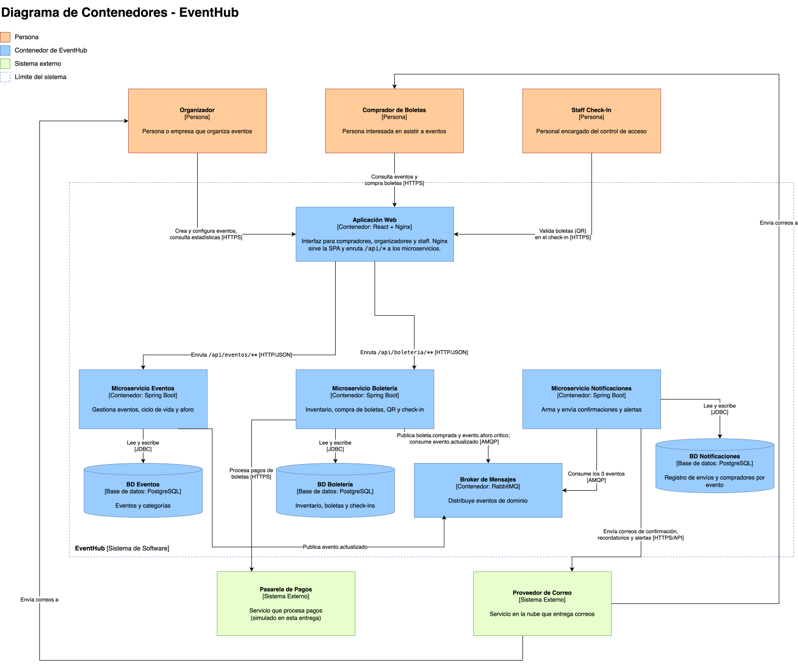

# EventHub: documento final de arquitectura

**Equipo:** Carlos Vargas, Karol Esquivel, David Murcia · **Materia:** Diseño y Arquitectura de Software · **Entrega:** 19 de noviembre de 2026

Este documento reúne en un solo lugar la evidencia del proyecto: la arquitectura (C4), los requerimientos, las decisiones (ADRs), el diseño de clases, la aplicación de SOLID, los tres patrones de diseño y los atributos de calidad. Cada afirmación enlaza al código o a la prueba que la demuestra, para que se pueda verificar en el repositorio.

## Índice

1. [El sistema en una página](#1-el-sistema-en-una-página)
2. [Arquitectura: C4 niveles 1 y 2](#2-arquitectura-c4-niveles-1-y-2)
3. [Requerimientos](#3-requerimientos)
4. [Decisiones de arquitectura (ADRs)](#4-decisiones-de-arquitectura-adrs)
5. [Diseño interno: Clean Architecture y diagramas de clases](#5-diseño-interno-clean-architecture-y-diagramas-de-clases)
6. [SOLID con evidencia en el código](#6-solid-con-evidencia-en-el-código)
7. [Patrones de diseño](#7-patrones-de-diseño)
8. [Atributos de calidad: cómo los cumplimos y cómo lo verificamos](#8-atributos-de-calidad-cómo-los-cumplimos-y-cómo-lo-verificamos)
9. [Limitaciones conocidas y trabajo futuro](#9-limitaciones-conocidas-y-trabajo-futuro)
10. [Cómo correr el sistema y las pruebas](#10-cómo-correr-el-sistema-y-las-pruebas)

---

## 1. El sistema en una página

EventHub gestiona eventos (conciertos, conferencias, ferias) y la venta de sus boletas con control de aforo. Lo forman tres microservicios en Spring Boot, cada uno con su propia base de datos PostgreSQL, que se comunican de forma asíncrona por RabbitMQ. A eso se suma una aplicación web en React servida por Nginx.

| Microservicio | Responsabilidad | Publica | Consume |
|---|---|---|---|
| **Eventos** | Crear eventos y gestionar su ciclo de vida (borrador → publicado → en curso → finalizado, o cancelado) | `evento.actualizado` | — |
| **Boletería** | Inventario por categoría, compra, QR firmado, check-in, aforo | `boleta.comprada`, `evento.aforo.critico` | `evento.actualizado` |
| **Notificaciones** | Correos de confirmación con QR, recordatorio de 24 h, avisos de cambio o cancelación, alerta al organizador | — | los tres |

La API REST está documentada con OpenAPI (Swagger): [`api/eventos.openapi.yaml`](api/eventos.openapi.yaml) y [`api/boleteria.openapi.yaml`](api/boleteria.openapi.yaml). Los mensajes tienen contratos con esquema JSON en [`contratos/`](contratos/).

## 2. Arquitectura: C4 niveles 1 y 2

### Nivel 1: Contexto


EventHub es una sola caja frente a sus actores (comprador, organizador, staff de check-in) y a dos sistemas externos: la pasarela de pagos y el proveedor de correo.

### Nivel 2: Contenedores



Por dentro: la aplicación web (con Nginx como único punto de entrada, [ADR-0005](adr/0005-acceso-frontend.md)), los tres microservicios, una base de datos por servicio ([ADR-0002](adr/0002-base-de-datos-por-microservicio.md)) y el broker RabbitMQ ([ADR-0001](adr/0001-comunicacion-asincrona-rabbitmq.md)).

## 3. Requerimientos

Están definidos con criterios de aceptación y trazabilidad a contenedores, ADRs e issues en [`requerimientos.md`](requerimientos.md). En resumen:

| ID | Requerimiento | Servicio |
|---|---|---|
| RF-01 | Compra de boletas por categoría | Boletería |
| RF-02 | Creación de eventos y ciclo de vida | Eventos |
| RF-03 | Check-in con QR de uso único | Boletería |
| RF-04 | Notificaciones por correo a los compradores | Notificaciones |
| RF-05 | Consulta del aforo y alerta al 90 % | Boletería y Notificaciones |
| RF-06 | Catálogo de eventos disponibles | Eventos |
| RNF-01 | Consistencia: no sobrevender | Boletería |
| RNF-02 | Disponibilidad ante caída de Notificaciones | Todos |
| RNF-03 | Seguridad: QR único y no falsificable | Boletería |
| RNF-04 | Rendimiento del catálogo y la compra | Eventos y Boletería |

## 4. Decisiones de arquitectura (ADRs)

Todas están en estado **Aceptado** y se encuentran en [`adr/`](adr/).

| ADR | Decisión | Requerimientos que atiende |
|---|---|---|
| [0001](adr/0001-comunicacion-asincrona-rabbitmq.md) | Comunicación asíncrona entre servicios con RabbitMQ | RF-04, RF-05, RNF-02 |
| [0002](adr/0002-base-de-datos-por-microservicio.md) | Una base de datos por microservicio | RNF-01, RNF-02 |
| [0003](adr/0003-control-de-concurrencia-y-dueno-del-aforo.md) | Boletería es dueña del aforo; descuento con UPDATE condicional atómico | RNF-01, RF-05 |
| [0004](adr/0004-qr-unico-y-no-falsificable.md) | QR = `boletaId.firma` con HMAC-SHA256 | RF-03, RNF-03 |
| [0005](adr/0005-acceso-frontend.md) | Nginx como único punto de entrada del frontend | RF-06, RNF-04 |
| [0006](adr/0006-replica-de-compradores-en-notificaciones.md) | Notificaciones guarda su propia copia de los compradores por evento | RF-04, RNF-02 |

## 5. Diseño interno: Clean Architecture y diagramas de clases

Cada microservicio tiene cuatro capas, y las dependencias solo apuntan hacia adentro:

```
interfaces  (controladores REST, consumidores de RabbitMQ)
     ↓
application (casos de uso y puertos: interfaces que el dominio necesita)
     ↓
domain      (entidades, value objects y reglas; Java puro, sin Spring)
     ↑
infrastructure (adaptadores: JPA, RabbitMQ, SMTP, HMAC; implementan los puertos)
```

No es solo una convención: lo **verifica una prueba automática con ArchUnit** en cada servicio ([Eventos](../services/eventos/src/test/java/com/eventhub/eventos/ArquitecturaTest.java), [Boletería](../services/boleteria/src/test/java/com/eventhub/boleteria/ArquitecturaTest.java), [Notificaciones](../services/notificaciones/src/test/java/com/eventhub/notificaciones/ArquitecturaTest.java)). Si alguien importa Spring o JPA en el dominio, o hace que la aplicación dependa de la infraestructura, el build falla.

```java
static final ArchRule domainNoDependeDeNadie = noClasses().that().resideInAPackage("..domain..")
        .should().dependOnClassesThat()
        .resideInAnyPackage("..application..", "..infrastructure..", "..interfaces..",
                "org.springframework..", "jakarta..", "org.hibernate..");
```

### Diagramas de clases

| Servicio | Diagrama | Qué muestra |
|---|---|---|
| Eventos | [clases-eventos](diagramas/clases-eventos.svg) ([.puml](diagramas/clases-eventos.puml)) | Agregado `Evento` con su máquina de estados y `CategoriaBoleta` |
| Boletería | [clases-boleteria](diagramas/clases-boleteria.svg) ([.puml](diagramas/clases-boleteria.puml)) | Jerarquía de boletas, Factory Method, Strategy, ISP y DIP |
| Notificaciones | [clases-notificaciones](diagramas/clases-notificaciones.svg) ([.puml](diagramas/clases-notificaciones.puml)) | Consumidores, casos de uso y copia local de eventos y compradores |

**Entidades siempre válidas.** Los objetos de dominio no se pueden construir en un estado inválido: `Evento.crear(...)` rechaza un evento sin categorías, con más cupos que aforo o con fecha pasada; `CategoriaBoleta` es un `record` que rechaza cupos ≤ 0 o una cortesía con precio. Los constructores son privados y se usan métodos de fábrica (`crear` para algo nuevo, `reconstruir` para lo que viene de la base). Así la regla vive en un solo lugar y ningún caso de uso se la puede saltar.

## 6. SOLID con evidencia en el código

### S: Responsabilidad única (SRP)

> Una clase debe tener una sola razón para cambiar.

- **Entre servicios:** las reglas de un evento (fechas, estados, categorías) cambian solo en Eventos; la generación y validación del QR cambia solo en Boletería; las plantillas de correo cambian solo en Notificaciones.
- **Dentro de un servicio:** la compra ([`ComprarBoletaUseCase`](../services/boleteria/src/main/java/com/eventhub/boleteria/application/ComprarBoletaUseCase.java)) *orquesta*, pero no sabe calcular precios (eso es de `PrecioStrategy`), ni armar boletas (de `FabricaBoleta`), ni firmar QR (de `GeneradorQr`), ni hablar con RabbitMQ (de `PublicadorBoleteria`). Si cambia el algoritmo de firma, solo cambia [`GeneradorQrHmac`](../services/boleteria/src/main/java/com/eventhub/boleteria/infrastructure/qr/GeneradorQrHmac.java).

### O: Abierto/cerrado (OCP)

> Abierto a extensión, cerrado a modificación.

Agregar un tipo de precio nuevo (por ejemplo, "2x1") se hace **sin tocar la compra**: se crea una clase que implementa [`PrecioStrategy`](../services/boleteria/src/main/java/com/eventhub/boleteria/domain/PrecioStrategy.java), se registra como bean en [`EstrategiasConfig`](../services/boleteria/src/main/java/com/eventhub/boleteria/infrastructure/EstrategiasConfig.java) y [`RegistroEstrategias`](../services/boleteria/src/main/java/com/eventhub/boleteria/application/RegistroEstrategias.java) la encuentra por su `tipo()`. Pasa lo mismo con un tipo de boleta nuevo: una subclase de `FabricaBoleta` más su registro en `FabricasConfig`.

```java
// ComprarBoletaUseCase: esta línea no cambia aunque se agreguen 10 estrategias nuevas
long precio = estrategias.estrategiaPara(inventario.tipoPrecio())
        .calcular(inventario.contextoPrecio(reloj.instant()));
var boleta = fabricas.fabricaPara(categoria).emitir(compra, precio);
```

### L: Sustitución de Liskov (LSP)

> Una subclase debe poder usarse en lugar de su clase base sin romper el comportamiento.

`BoletaGeneral`, `BoletaVIP`, `BoletaEstudiante` y `BoletaCortesia` son intercambiables en el check-in: el caso de uso trabaja con [`Boleta`](../services/boleteria/src/main/java/com/eventhub/boleteria/domain/Boleta.java) y nunca pregunta por el tipo concreto. Para garantizarlo, la regla de ingreso es `final`, así que ninguna subclase puede cambiarla:

```java
/** La regla es la MISMA para VIP, General, Estudiante y Cortesía; ninguna subclase la puede cambiar (LSP). */
public final boolean puedeIngresar() {
    return estado == EstadoBoleta.ACTIVA;
}
```

Las subclases solo **agregan** invariantes propias (la de estudiante exige carnet; la cortesía exige quién la emitió y precio 0), y no debilitan las de la base.

### I: Segregación de interfaces (ISP)

> Ningún cliente debe depender de métodos que no usa.

El check-in depende de [`CheckInService`](../services/boleteria/src/main/java/com/eventhub/boleteria/application/CheckInService.java), una interfaz con un solo método (`validar`). El controlador del staff ([`CheckInController`](../services/boleteria/src/main/java/com/eventhub/boleteria/interfaces/CheckInController.java)) no ve nada de la compra, y [`BoletaController`](../services/boleteria/src/main/java/com/eventhub/boleteria/interfaces/BoletaController.java) no ve nada del check-in.

Pasa lo mismo con el QR: [`GeneradorQr`](../services/boleteria/src/main/java/com/eventhub/boleteria/application/GeneradorQr.java) (lo usa la compra) y [`ValidadorQr`](../services/boleteria/src/main/java/com/eventhub/boleteria/application/ValidadorQr.java) (lo usa el check-in) son dos interfaces separadas, aunque las implemente la misma clase `GeneradorQrHmac`. La compra no puede validar QR y el check-in no puede emitirlos.

### D: Inversión de dependencias (DIP)

> Los módulos de alto nivel dependen de abstracciones, no de detalles.

Los casos de uso declaran **puertos** (interfaces en `application`), y la infraestructura los implementa:

| Puerto (abstracción) | Adaptador (detalle) |
|---|---|
| [`InventarioRepository`](../services/boleteria/src/main/java/com/eventhub/boleteria/application/InventarioRepository.java) | [`JpaInventarioRepository`](../services/boleteria/src/main/java/com/eventhub/boleteria/infrastructure/persistencia/JpaInventarioRepository.java) |
| [`PublicadorBoleteria`](../services/boleteria/src/main/java/com/eventhub/boleteria/application/PublicadorBoleteria.java) | [`RabbitPublicadorBoleteria`](../services/boleteria/src/main/java/com/eventhub/boleteria/infrastructure/messaging/RabbitPublicadorBoleteria.java) |
| [`PasarelaPagos`](../services/boleteria/src/main/java/com/eventhub/boleteria/application/PasarelaPagos.java) | [`PasarelaPagosSimulada`](../services/boleteria/src/main/java/com/eventhub/boleteria/infrastructure/pagos/PasarelaPagosSimulada.java) |
| [`PublicadorEventos`](../services/eventos/src/main/java/com/eventhub/eventos/application/PublicadorEventos.java) | [`RabbitPublicadorEventos`](../services/eventos/src/main/java/com/eventhub/eventos/infrastructure/messaging/RabbitPublicadorEventos.java) |
| [`EnviadorCorreo`](../services/notificaciones/src/main/java/com/eventhub/notificaciones/application/EnviadorCorreo.java) | [`SmtpEnviadorCorreo`](../services/notificaciones/src/main/java/com/eventhub/notificaciones/infrastructure/correo/SmtpEnviadorCorreo.java) |

Dos consecuencias concretas:

1. **Las pruebas no necesitan infraestructura.** Las pruebas de casos de uso usan fakes en memoria (`InventariosEnMemoria`, `PasarelaFalsa`, `PublicadorEnMemoria`), y por eso corren en milisegundos.
2. **Cambiar un proveedor no toca el negocio.** Conectar una pasarela real (PayU, Wompi) es escribir un adaptador nuevo de `PasarelaPagos`; la compra no cambia.

Hasta el tiempo es una dependencia invertida: los casos de uso reciben un `Clock` y el dominio recibe `Instant ahora` como parámetro, en vez de llamar a `Instant.now()`. Así las reglas que dependen del tiempo (early bird, fecha futura) se prueban de forma determinista.

## 7. Patrones de diseño

### 7.1 Factory Method: tipos de boleta

**Problema.** Hay cuatro tipos de boleta con reglas distintas: la VIP trae beneficios, la de estudiante exige carnet y la cortesía exige quién la emitió y no se cobra. Si la compra los creara con un `switch` por tipo, cada tipo nuevo obligaría a modificar la compra (viola OCP), y las reglas de cada tipo quedarían mezcladas en un solo método.

**Solución.** [`FabricaBoleta`](../services/boleteria/src/main/java/com/eventhub/boleteria/domain/FabricaBoleta.java) define el flujo común en un método `final` (`emitir`) y deja a cada subclase decidir *qué clase concreta crear* (`crearBoleta`, el factory method). [`RegistroFabricas`](../services/boleteria/src/main/java/com/eventhub/boleteria/application/RegistroFabricas.java) elige la fábrica según la categoría.

```java
public abstract class FabricaBoleta {
    public abstract TipoBoleta tipo();

    /** Lo que usa la compra. Es final: las subclases no pueden cambiar este flujo. */
    public final Boleta emitir(Compra compra, long precio) {
        if (compra.categoria() != tipo()) {
            throw new ReglaDeNegocioException(
                    "La fábrica de " + tipo() + " no puede emitir una boleta " + compra.categoria());
        }
        return crearBoleta(compra, precio);
    }

    /** El "factory method": cada subclase decide qué clase concreta crear. */
    protected abstract Boleta crearBoleta(Compra compra, long precio);
}
```

**Evidencia:** [`FabricaBoletaTest`](../services/boleteria/src/test/java/com/eventhub/boleteria/domain/FabricaBoletaTest.java), [`RegistroFabricasTest`](../services/boleteria/src/test/java/com/eventhub/boleteria/application/RegistroFabricasTest.java), [`BoletaTest`](../services/boleteria/src/test/java/com/eventhub/boleteria/domain/BoletaTest.java).

### 7.2 Strategy: precios

**Problema.** El precio de una boleta se calcula de tres formas: fijo, early bird (descuento si se compra antes de una fecha límite) y dinámico (sube con la ocupación). Con `if/else` dentro de la compra, cada regla nueva tocaría el flujo más delicado del sistema.

**Solución.** La interfaz [`PrecioStrategy`](../services/boleteria/src/main/java/com/eventhub/boleteria/domain/PrecioStrategy.java) tiene tres implementaciones intercambiables: [`PrecioFijo`](../services/boleteria/src/main/java/com/eventhub/boleteria/domain/PrecioFijo.java), [`PrecioEarlyBird`](../services/boleteria/src/main/java/com/eventhub/boleteria/domain/PrecioEarlyBird.java) y [`PrecioDinamico`](../services/boleteria/src/main/java/com/eventhub/boleteria/domain/PrecioDinamico.java). Cada categoría del inventario guarda su `TipoPrecio`, y la compra pide la estrategia en tiempo de ejecución. Toda la información que necesitan llega en un `ContextoPrecio` inmutable.

```java
public interface PrecioStrategy {
    TipoPrecio tipo();
    long calcular(ContextoPrecio contexto);   // precio de UNA boleta en pesos
}

public class PrecioEarlyBird implements PrecioStrategy {
    public long calcular(ContextoPrecio contexto) {
        var p = contexto.parametros();
        // (validaciones de fecha límite y descuento entre 1 y 100)
        if (contexto.fechaCompra().isBefore(p.fechaLimite())) {
            return contexto.precioBase() * (100 - p.descuentoPorcentaje()) / 100;
        }
        return contexto.precioBase();
    }
}
```

**Evidencia:** [`PrecioStrategyTest`](../services/boleteria/src/test/java/com/eventhub/boleteria/domain/PrecioStrategyTest.java) (early bird antes y después de la fecha límite, dinámico según ocupación, con un reloj fijo) y [`RegistroEstrategiasTest`](../services/boleteria/src/test/java/com/eventhub/boleteria/application/RegistroEstrategiasTest.java).

### 7.3 Observer (publicación/suscripción): cambios del evento

**Problema.** Cuando un evento se cancela o cambia de fecha o lugar, hay que avisar a todos los compradores y actualizar el inventario. Si Eventos llamara directamente a Notificaciones y a Boletería, quedaría acoplado a ellos: una caída de Notificaciones haría fallar la cancelación, y agregar un nuevo interesado obligaría a modificar Eventos.

**Solución.** Observer a nivel de arquitectura, con RabbitMQ como intermediario. Eventos (el *sujeto*) publica `evento.actualizado` en un exchange y no sabe quién escucha. Boletería y Notificaciones (los *observadores*) se suscriben con su propia cola. Agregar un nuevo observador (por ejemplo, un servicio de analítica) es crear una cola nueva: Eventos no cambia.

```java
// Eventos: el sujeto solo conoce el puerto, no a sus observadores
publicador.eventoActualizado(evento, Set.of(TipoCambio.CANCELADO), null);

// Boletería: un observador bloquea las ventas y cancela las boletas
if (cambios.contains(TipoCambio.CANCELADO)) {
    aforos.bloquearVentas(eventoId);
    boletas.cancelarPorEvento(eventoId);
}

// Notificaciones: otro observador avisa a cada comprador (un correo por persona)
```

El mismo patrón se usa con `boleta.comprada` (Boletería → Notificaciones, correo con QR) y `evento.aforo.critico` (Boletería → Notificaciones, alerta al organizador). Los contratos están en [`contratos/`](contratos/).

Como la entrega es *al menos una vez*, los observadores son **idempotentes**: guardan el `messageId` de cada mensaje procesado e ignoran los repetidos, e ignoran los mensajes viejos que llegan fuera de orden (por `fechaEmision`).

**Evidencia:** [`SincronizarEventoUseCaseTest`](../services/boleteria/src/test/java/com/eventhub/boleteria/application/SincronizarEventoUseCaseTest.java), [`ProcesarEventoActualizadoUseCaseTest`](../services/notificaciones/src/test/java/com/eventhub/notificaciones/application/ProcesarEventoActualizadoUseCaseTest.java) y [`ProcesarBoletaCompradaUseCaseTest`](../services/notificaciones/src/test/java/com/eventhub/notificaciones/application/ProcesarBoletaCompradaUseCaseTest.java) (incluye `unMensajeRepetidoNoEnviaOtroCorreo`).

### Otros patrones que aparecen

- **Ports & Adapters (Hexagonal):** los puertos y adaptadores de la sección DIP.
- **Repository:** `EventoRepository`, `BoletaRepository`, etc., ocultan JPA al dominio.
- **State (en forma de máquina de estados):** [`EstadoEvento.puedePasarA`](../services/eventos/src/main/java/com/eventhub/eventos/domain/EstadoEvento.java) concentra las transiciones permitidas.
- **Registry:** `RegistroFabricas` y `RegistroEstrategias` resuelven la implementación por tipo.

## 8. Atributos de calidad: cómo los cumplimos y cómo lo verificamos

### RNF-01: Consistencia (no sobrevender)

**Cómo lo cumplimos ([ADR-0003](adr/0003-control-de-concurrencia-y-dueno-del-aforo.md)).** El patrón ingenuo "leo los disponibles, compruebo que haya y resto" (*check-then-act*) falla con compras simultáneas: dos compras leen "queda 1" y ambas venden. Por eso la condición la evalúa **la base de datos en una sola sentencia atómica**:

```sql
update InventarioCategoriaEntity i
set i.disponibles = i.disponibles - 1, i.vendidas = i.vendidas + 1
where i.eventoId = :eventoId and i.categoria = :categoria and i.disponibles >= 1
```

Si la sentencia afecta 0 filas, no había cupo y la compra se rechaza con 409. Todo ocurre en una transacción: si el pago se rechaza después de descontar, el cupo vuelve. La alerta del 90 % usa la misma técnica (`... and a.alertaEnviada = false`), así que se publica **una sola vez** aunque varias compras crucen el umbral al mismo tiempo. Y el check-in pasa la boleta de ACTIVA a USADA con un UPDATE condicional, así que el mismo QR no entra dos veces aunque lo escaneen en dos puertas a la vez.

**Cómo lo verificamos.**
- Prueba automática [`CompraConcurrenteTest.cienCompradoresPorDiezCuposNuncaVendenDeMas`](../services/boleteria/src/test/java/com/eventhub/boleteria/CompraConcurrenteTest.java): 100 hilos compran a la vez sobre 10 cupos (con un `CountDownLatch` para que arranquen juntos). Resultado: exactamente 10 compras exitosas, 90 "sin cupos", y 10 boletas en la base.
- `siElPagoSeRechazaElCupoVuelveAlInventario` en la misma clase.
- Manual, sobre Docker: 50 `curl` en paralelo contra una categoría con 8 cupos dieron 8 respuestas 201 y 42 respuestas 409, y la alerta de aforo se publicó una sola vez.

### RNF-02: Disponibilidad (Notificaciones caído)

**Cómo lo cumplimos ([ADR-0001](adr/0001-comunicacion-asincrona-rabbitmq.md), [ADR-0006](adr/0006-replica-de-compradores-en-notificaciones.md)).**
- La compra no llama a Notificaciones: publica `boleta.comprada` y termina. Si Notificaciones está caído, el mensaje espera en una **cola durable** de RabbitMQ.
- Boletería publica **después del commit** (`TransactionSynchronization.afterCommit`): nunca se envía un correo por una compra que luego se deshizo.
- Las colas tienen **cola de mensajes muertos (DLQ)**: un mensaje que falla tras los reintentos no se pierde, queda para revisión.
- Notificaciones guarda su propia copia de compradores y eventos (ADR-0006), así que puede avisar de una cancelación sin preguntarle nada a Boletería.
- Cada servicio tiene su propia base (ADR-0002): la caída de una base no tumba a los otros servicios.

**Cómo lo verificamos.**
- Manual (se muestra en la demo): `docker compose stop notificaciones` → se hacen compras, que responden 201 → en el panel de RabbitMQ (http://localhost:15672) se ven los mensajes acumulados en `notificaciones.boleta-comprada` → `docker compose start notificaciones` → los correos llegan a Mailpit, uno por compra, sin duplicados.
- Idempotencia: `unMensajeRepetidoNoEnviaOtroCorreo` y `siElCorreoFallaNoMarcaElMensajeComoProcesado` en [`ProcesarBoletaCompradaUseCaseTest`](../services/notificaciones/src/test/java/com/eventhub/notificaciones/application/ProcesarBoletaCompradaUseCaseTest.java).

### RNF-03: Seguridad (QR único y no falsificable)

**Cómo lo cumplimos ([ADR-0004](adr/0004-qr-unico-y-no-falsificable.md)).** El QR es `boletaId.firma`, donde la firma es **HMAC-SHA256** del id de la boleta con una clave secreta que solo conoce Boletería (`BOLETERIA_QR_SECRETO`, en variables de entorno y nunca en el repositorio).
- **Único:** el `boletaId` es un UUID.
- **No falsificable:** sin la clave no se puede calcular la firma de otra boleta, aunque se conozca el código de una.
- **Comparación segura:** la firma se compara con `MessageDigest.isEqual` (tiempo constante), para no filtrar información por tiempos de respuesta.
- **Uso único:** el check-in cambia la boleta de ACTIVA a USADA de forma atómica (RNF-01).
- **Boleta del evento correcto:** el staff valida en la entrada de un evento concreto (`eventoId`); un QR auténtico de otro evento se rechaza y no se marca como usada.

**Cómo lo verificamos.** [`ValidacionQrHmacTest`](../services/boleteria/src/test/java/com/eventhub/boleteria/infrastructure/qr/ValidacionQrHmacTest.java): una letra cambiada en la firma se rechaza, poner la firma de una boleta en otra se rechaza y un QR firmado con otra clave se rechaza. [`GeneradorQrHmacTest`](../services/boleteria/src/test/java/com/eventhub/boleteria/infrastructure/qr/GeneradorQrHmacTest.java): el servicio no arranca sin secreto. [`CheckInDePuntaAPuntaTest`](../services/boleteria/src/test/java/com/eventhub/boleteria/CheckInDePuntaAPuntaTest.java): con el QR de la compra se entra una sola vez, un QR alterado responde 409 y en la entrada de otro evento se rechaza sin gastar la boleta (`enLaEntradaDeOtroEventoSeRechazaYLaBoletaSigueActiva`).

### RNF-04: Rendimiento

**Cómo lo cumplimos.** La compra hace pocas operaciones cortas en una transacción, sin bloqueos largos (el UPDATE condicional bloquea solo la fila de esa categoría). El correo y el QR en imagen se generan fuera de la compra, en Notificaciones. El catálogo es una sola consulta filtrada por estado y fecha.

**Cómo lo verificamos.** Con la prueba de concurrencia y los 50 `curl` en paralelo. **No hicimos una prueba de carga formal** con medición de percentil 95 (JMeter, k6 o Gatling); queda como trabajo futuro (sección 9).

## 9. Limitaciones conocidas y trabajo futuro

Las dejamos explícitas porque una decisión de alcance documentada es mejor que un hueco escondido.

| Limitación | Por qué / impacto | Cómo se resolvería |
|---|---|---|
| **No hay reservas de 24 h** (parte de RF-01) | Se priorizó la compra con control de concurrencia | Estado RESERVADA (ya existe en el modelo) y un job que libere las vencidas |
| **El tipo de precio no se configura desde Eventos** | El inventario nace con precio FIJO; early bird y dinámico funcionan y están probados, pero se activan en la base | Agregar `tipoPrecio` y sus parámetros a `CategoriaBoleta` y al contrato `evento.actualizado` |
| **La cortesía solo se emite por API** | No hay pantalla para que el organizador la emita | Pantalla del organizador que llame a la compra con `emitidaPor` |
| **Sesión simulada, sin autenticación** | JWT con roles era bonificación (#32) | Spring Security + JWT con roles comprador / organizador / staff |
| **Compra simultánea a la cancelación** | Una compra que entra justo antes de procesar `evento.actualizado` puede quedar ACTIVA | Revisar el estado del evento dentro de la transacción de compra |
| **Eventos publica sin outbox** | Si RabbitMQ cae justo después de guardar, el mensaje se pierde (se registra en el log) | Patrón *Transactional Outbox* |
| **Sin prueba de carga formal (RNF-04)** | Solo verificamos concurrencia | Script de k6 con 100 usuarios midiendo p95 |

## 10. Cómo correr el sistema y las pruebas

```bash
cp .env.example .env            # y completar los secretos
docker compose up -d --build
```

| Qué | Dónde |
|---|---|
| Aplicación web | http://localhost:8080 |
| Swagger de Eventos | http://localhost:8081/swagger-ui.html |
| Swagger de Boletería | http://localhost:8082/swagger-ui.html |
| Panel de RabbitMQ | http://localhost:15672 |
| Correos (Mailpit) | http://localhost:8025 |

Pruebas de cada servicio:

```bash
cd services/eventos        && ./mvnw clean test
cd services/boleteria      && ./mvnw clean test
cd services/notificaciones && ./mvnw clean test
```
